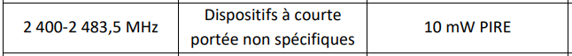

# Antenne WiFi à balayage horizontal

**Projet Circuit ESC 2026-2027 M. Martin**

## Cahier des charges :    
- Polarisation linéaire     
- Gain : 20 dBi -> négociable     
- Dépointage : +/- 60° (plan horizontal)     
- Ouverture : 30°+/-5° dans le plan vertical (fixe)     
- Bande ISM Wifi : VSWR < 2     

## Conditions d'utilisation de la bande

## Précisions supplémentaires
2 PCBS : matrice Butler et antenne élémentaire en 4 exemplaires, (si on a le temps switch 1 vers 4)    
PCBS séparés → réseau de 4 antennes (à vérifier) (4 PCBS séparés 1 par antenne)    
Matrice Butler : Elise F, Julie D    
Antenne élémentaire : Awa, Callum    
envoi PCB avant vacances de Noël    

Pas plus de 1 ou 2 séances pour les calculs théoriques

## Réseau d'antennes patch
> Callum + Awa

[README Antenne](antenne/README.md)

*Substrat Antenne*
- PTFE ZYF255DA eps_r=2.55, tan_delta=0.0018 :
  - h = 1.52 mm (raison : bande passante vs 0.76mm)

## Matrice Butler 4x4
> Elise + Julie

[README Butler](butler/README.md)